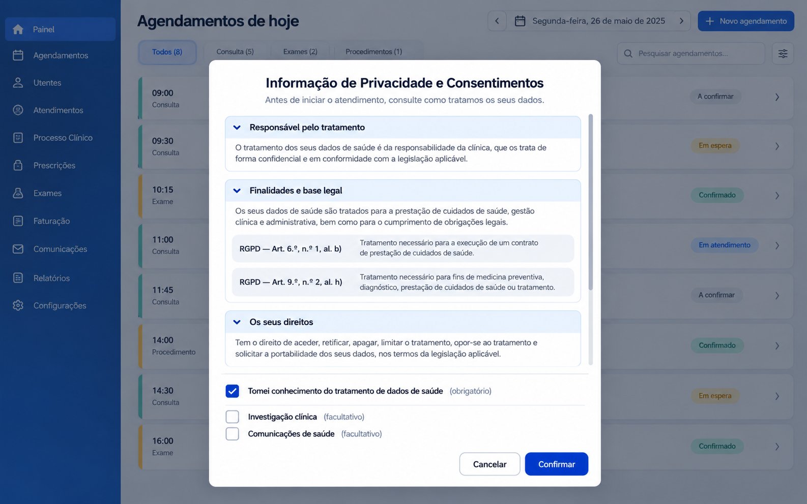
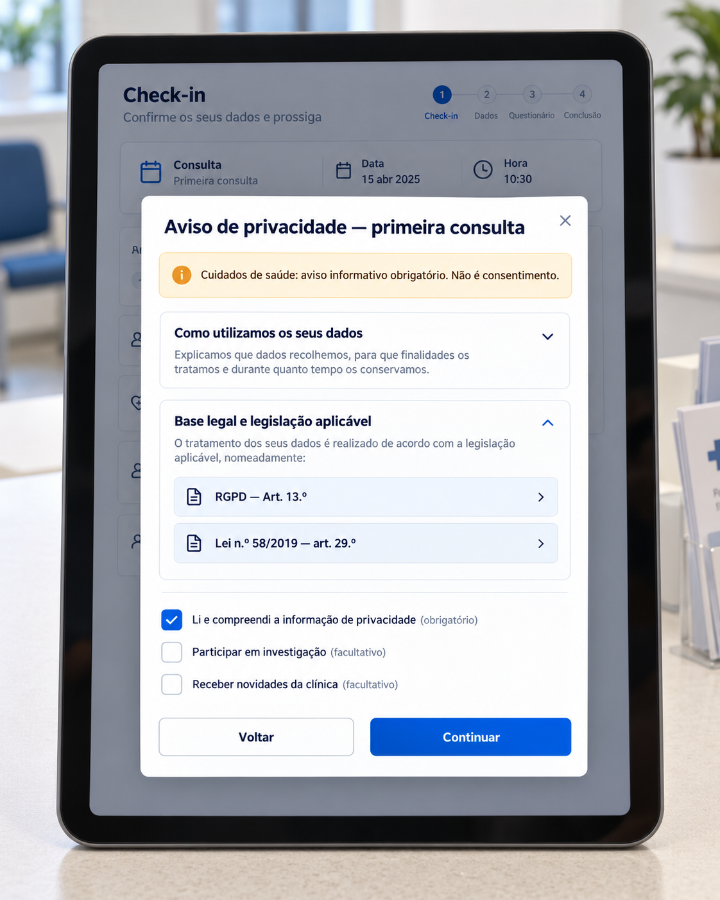
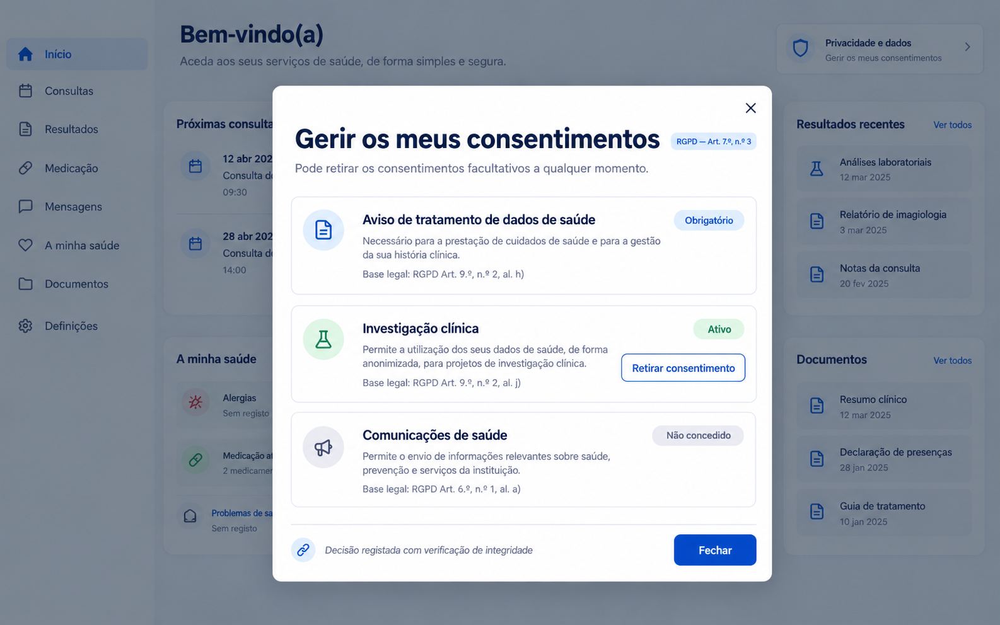

# rgpd-mcp

<p align="center"></p>

**Versão 1.1.0**

Servidor **MCP** (Model Context Protocol) + **API HTTP** + **modal web** para criar consentimentos e avisos de
privacidade conforme o **RGPD (Regulamento (UE) 2016/679)** e as leis nacionais de proteção de dados de 30 países
europeus, **no idioma de cada país**. Pensado para sistemas de saúde. Funciona com qualquer linguagem (React, Go, Java,
JavaScript, Delphi, Rust, Python, C#, PHP…) porque o contrato é HTTP + uma janela web.

## Documentação

| Documento | Conteúdo |
|---|---|
| [docs/VISAO-GERAL.md](docs/VISAO-GERAL.md) | O que é, arquitetura, componentes |
| [docs/INSTALACAO.md](docs/INSTALACAO.md) | Instalação, build, registo nos clientes MCP, agente, CLI |
| [docs/CLIENTS.md](docs/CLIENTS.md) | Formato de configuração de cada cliente (Claude Code, Codex, Gemini CLI, Antigravity, OpenCode, VS Code) |
| [docs/FERRAMENTAS-MCP.md](docs/FERRAMENTAS-MCP.md) | As 13 ferramentas, recursos e prompts MCP |
| [docs/API-HTTP.md](docs/API-HTTP.md) | Rotas HTTP, autenticação, widget `<rgpd-consent-modal>`, segurança |
| [docs/INTEGRACAO.md](docs/INTEGRACAO.md) | Integração no seu sistema (agente `rgpd-integrador` ou manual), exemplos |
| [docs/MODELO-DE-DADOS.md](docs/MODELO-DE-DADOS.md) | Estados `verified/inferred/unverified`, perfil de país, evidência, como estender |
| [docs/REGRAS-E-VALIDACOES.md](docs/REGRAS-E-VALIDACOES.md) | Códigos de erro/aviso do construtor, menores (Art. 8), idiomas |
| [docs/PAISES.md](docs/PAISES.md) | **Ficha de cada país integrado** (gerada a partir dos dados) |
| [docs/LEGAL-METHOD.md](docs/LEGAL-METHOD.md) | Método de verificação jurídica |
| [docs/LIMITACOES.md](docs/LIMITACOES.md) | Avisos e lacunas conhecidas |

## Estado real

| Componente | Estado |
|---|---|
| RGPD oficial em **24 línguas** da UE (99 artigos, 173 considerandos) | ✅ Serviço de Publicações da UE, SHA-256 por língua |
| 30 países (UE-27 + NO, IS, LI): autoridade de controlo | ✅ lista oficial do EDPB |
| Lei nacional, idade do Art. 8, disposições de saúde, legislação setorial de saúde | ⚠️ **22 países verificados**, 8 parciais (DE, HU, LI, LU, MT, NL, PL, RO), 0 sem verificação. Setorial de saúde em 26 países (faltam BE, IE, MT, RO) |
| Construtor que **recusa** desenhos ilegais | ✅ |
| Modal acessível (Web Component) + página para iframe/WebView | ✅ Testado |
| Ledger de consentimento (cadeia de hash, retirada, verificação) | ✅ |
| Instaladores (6 clientes + genérico) | ✅ formatos verificados em docs oficiais; só o Claude Code instalado de verdade |
| Rótulos da interface | 25 idiomas |
| Ferramentas MCP | 13 ferramentas, 2 recursos (`rgpd://gdpr/…`, `rgpd://country/…`) e 2 prompts (`integrar_no_sistema`, `healthcare_first_visit`) |
| Agente de integração | `rgpd-integrador`: explora o projeto, implementa backend, modal, bloqueio no servidor e saída alternativa, e testa |
| API HTTP | Criação de documentos, registo de decisões, retirada (Art. 7(3)), estado e verificação do ledger; chave de API ou token de captura de curta duração |
| Consentimento | 16 categorias de dados, bases do Art. 6(1) e condições do Art. 9(2); responsável legal para menores (Art. 8); retirada com um clique |
| Linguagens de integração | Snippets para HTML, React, Node, Go, Java, Rust, Delphi, Python, C# e PHP |
| Exemplos executáveis | `examples/clinic` (Node) e `examples/clinic-react` (React + TypeScript) |
| Segurança | Loopback por omissão, CSP no modal, tokens HMAC presos a documento e titular, `subjectRef` pseudónimo, ledger encadeado por hash |
| País e idioma por IP (opcional) | `POST /v1/resolve-locale` e ferramenta `resolve_locale` sugerem país e idioma a partir do país da clínica, da escolha do utilizador, do IP (base GeoIP **local**, `--geoip-db`; `geoip-download` obtém a base gratuita DB-IP) e do `Accept-Language`. Seletor opcional de país/idioma no modal. Desligado por omissão |
| Requisitos | Node ≥ 20 |

Reino Unido e Suíça **não** estão incluídos.

## Clientes suportados

| Cliente | Comando de instalação |
|---|---|
| **Claude Code** | `node dist/cli.js install claude-code --scope user` |
| **Codex** | `node dist/cli.js install codex` |
| **Gemini CLI** | `node dist/cli.js install gemini` |
| **Antigravity IDE** e **Antigravity** (CLI) | `node dist/cli.js install antigravity` (um só ficheiro de configuração, partilhado pela IDE e pela CLI) |
| **OpenCode** | `node dist/cli.js install opencode --scope project` |
| **VS Code / Visual Studio Code** | `node dist/cli.js install vscode --scope project` |
| **Claude Desktop, Cursor, Windsurf e qualquer cliente MCP** | `node dist/cli.js install generic` (imprime o JSON `mcpServers`) |

Detalhes e formatos de configuração em [docs/CLIENTS.md](docs/CLIENTS.md). Use `--dry-run` para ver o que será alterado.

## Início rápido

Requer Node ≥ 20.

```bash
git clone https://github.com/euricotecnologia/rgpd-mcp.git
cd rgpd-mcp
npm install
npm run build
npm test
node dist/cli.js install claude-code --scope user
node dist/cli.js install-agent
node dist/cli.js http
```

Depois, no Claude Code, na pasta do seu sistema (sessão nova):

> `@agent-rgpd-integrador crie o consentimento RGPD ao iniciar o atendimento do paciente. Clínica: <nome>, país: PT.`

O agente explora o projeto, valida o desenho, escreve backend + modal + bloqueio no servidor + saída alternativa + testes e relata o que não foi verificado. Detalhes em [docs/INTEGRACAO.md](docs/INTEGRACAO.md).

## Como fica na prática

> As quatro imagens deste repositório são **ilustrações conceptuais** da interface (não capturas de ecrã do produto). Os textos e as referências legais que aparecem nelas são exemplos visuais; os textos reais vêm do RGPD oficial e das leis nacionais verificadas ([docs/PAISES.md](docs/PAISES.md)).

**Início do atendimento, em sistema de gestão clínica**



**Check-in da primeira consulta, em tablet na receção**

<p align="center"></p>

**Portal do paciente: gerir e retirar consentimentos (Art. 7.º, n.º 3)**



## Atualização

```bash
git pull
npm install
npm run build
npm test
node dist/cli.js install-agent --force      # atualiza o agente rgpd-integrador
```

Depois de atualizar, **reinicie** o `node dist/cli.js http` e abra uma sessão nova no seu cliente MCP. O registo do MCP não precisa de ser refeito, salvo se mudar o caminho da pasta (repita `install <cliente>`). Os dados de consentimento em `~/.rgpd-mcp/` são preservados; `node dist/cli.js verify-ledger` confirma a integridade da cadeia de hash.

## Modo de usar

1. **Com o agente (recomendado):** `@agent-rgpd-integrador …` na pasta do seu sistema, como acima.
2. **À mão, por HTTP:** backend → `POST /v1/consent-documents`; frontend mostra o modal; backend lê `GET /v1/consents?subjectRef=…` e só então libera o atendimento. Guia completo em [docs/INTEGRACAO.md](docs/INTEGRACAO.md) e [docs/API-HTTP.md](docs/API-HTTP.md).
3. **Consultar a lei:** peça ao assistente (com o MCP instalado) o perfil de um país (`get_country_law`) ou um artigo do RGPD em qualquer língua da UE (`get_gdpr_article`). Lista das ferramentas em [docs/FERRAMENTAS-MCP.md](docs/FERRAMENTAS-MCP.md).
4. **Diagnóstico:** `node dist/cli.js doctor` e `node dist/cli.js coverage`.

## Exemplo da primeira consulta
Cuidados de saúde = `legalBasis: contract` + `art9Condition: health_care` + `required: true` → **aviso informativo** (Art. 9(2)(h)), não consentimento. Marketing, investigação ou partilha com terceiros = finalidades **separadas**, `consent`, facultativas, desmarcadas (Art. 7(2),(4); considerandos 32 e 43). Se o paciente não confirma o aviso, o sistema mostra a mensagem e a saída alternativa, e o servidor bloqueia o atendimento. Exemplos executáveis: `examples/clinic/` e `examples/clinic-react/`.

## Estado persistente
`~/.rgpd-mcp/` (ou `RGPD_MCP_STATE_DIR`): `ledger.jsonl`, `documents/`, `capture.secret`. `subjectRef` é pseudónimo (nunca nome, e-mail ou NIF).
